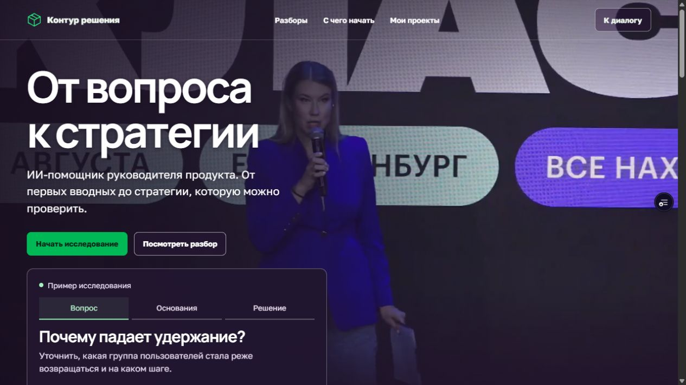
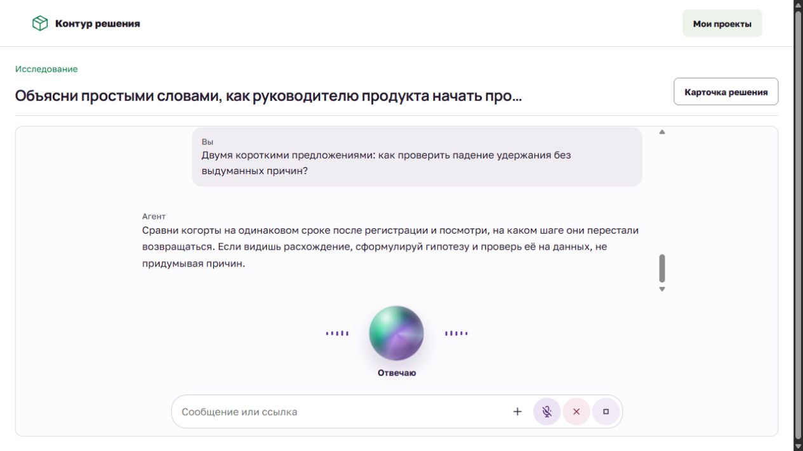
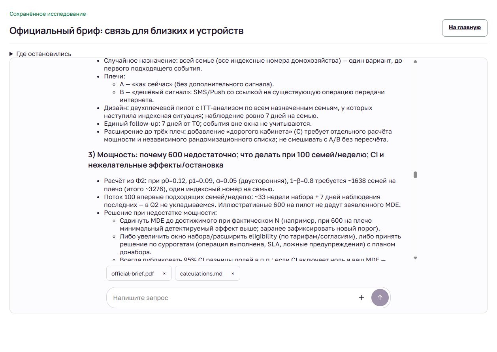
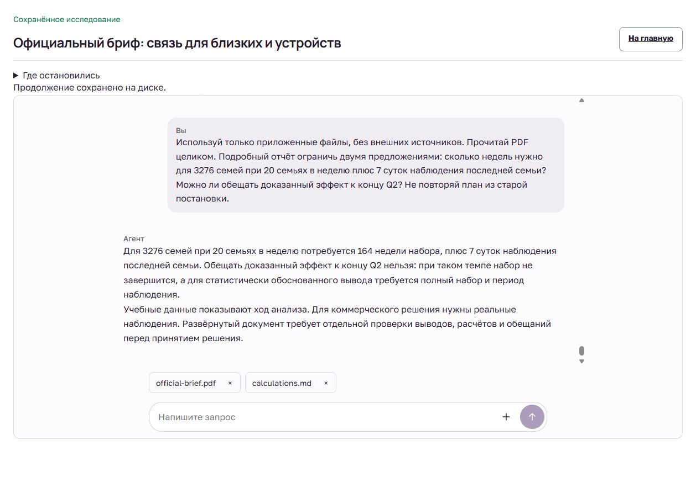

# Контур решения · ИИ-помощник руководителя продукта

**[Попробовать сервис](https://decision-contour.vercel.app)** · **[Код и полный разбор](https://github.com/blad3r81/contour-product-strategist)** · **[Видео работы](https://disk.yandex.ru/i/5J_mblxmcZl_lA)**

## Задача и мой вклад

Я разработал проект по задаче хакатона «Стратег Фабрики продуктов» МегаФона. Помощник помогает руководителю пройти от вопроса «почему падает удержание?» до вариантов, обоснованной продуктовой и коммуникационной стратегии и плана проверки. После выбора можно вернуться к основаниям решения и обсудить новые данные.

Проработал пользовательский путь, собрал веб-интерфейс, Node API, инструкции агента, интеграции с аналитической и речевыми моделями, сохранение состояния и проверки. В разработке, отладке и проверке материалов использовал Codex. Это самостоятельная портфолио-работа; проект не проходил оценивание жюри и не является официальным продуктом МегаФона.

## Голос, чат и материалы в одном проекте

Можно писать, надиктовывать запрос или вести голосовой разговор, сохраняя чат и вложения. Подключены GigaChat для анализа, Zipformer для разговорного распознавания, Qwen ASR для диктовки и Silero для мужской озвучки. Предусмотрены выключение микрофона, остановка ответа и продолжение текстом.

Агент читает PDF/DOCX, CSV/Excel, открытые страницы и изображения. Инструменты проверяют доли, знаменатели и ошибки данных, строят графики. Короткое видео разбирается по четырём кадрам с таймкодами: до 60 секунд и 2 МБ, без звуковой дорожки.

*На снимке запрос отправлен текстом при выключенном микрофоне. Голосовая цепочка проверена отдельно через сервер и ручным разговором пользователя; изображение само по себе не доказывает качество звука.*

## Сквозная проверка на учебном брифе

Взял официальный бриф «Связь для близких и собственных устройств»: 11 страниц, 29 458 извлечённых символов. Прошёл с агентом постановку, сравнение вариантов, предложение клиенту, проверку эффекта, экономику, план и продолжение после паузы. Сохранил исходник, запросы, сырые ответы, калькулятор и исправления.

Итог — стратегия из пяти частей с продуктовым и коммуникационным планом. Учебная экономика оставляет разрыв 5,5 млн руб. до цели, а срок проверки ограничивает обещания. Ошибки первых ответов разобраны; финальная редакция проверена с помощью Codex. Это учебный оператор, не данные и не доказанный эффект МегаФона.

## Что отличает проект

Решение сохраняется вместе с основаниями, ответственным, показателем и условием пересмотра. При новых данных агент сверяет эти условия и предлагает действие, оставляя выбор человеку. Для локального запуска есть числовой монитор с восстановлением и защитой от повторов. В публичной версии история хранится в браузере; постоянный фон после закрытия вкладки не работает.

## Стек и результат

React 19, TypeScript, Vite, Node.js 24, Python, API GigaChat, Zipformer/sherpa-onnx, Qwen ASR, Silero, GitHub Actions, Vercel и CPU ModelScope. Репозиторий содержит отдельную папку агента с CLI, методиками и контрольными точками. Сборка и проверки инструментов выполняются на Windows и Ubuntu.

Работающая демонстрация показывает полный путь от материалов до стратегии и пересмотра. В голосе остаются задержки, ответы требуют сверки; промышленный SLA и экономия против аналитика не заявлены. Полные ограничения, доказательства и инструкция запуска — в [README проекта](https://github.com/blad3r81/contour-product-strategist).

[Вернуться ко всем кейсам](../README.md)
