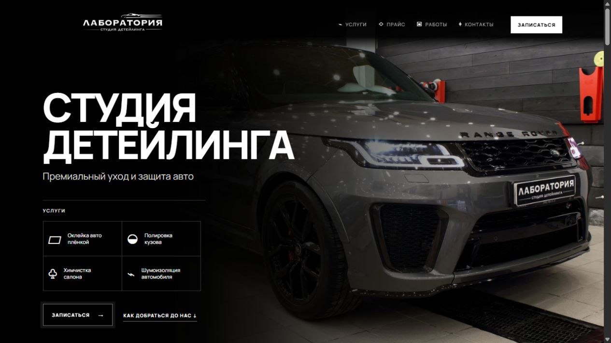

# Лаборатория

**Сайт детейлинг-студии** · [Открыть сайт](https://laboratoriya-2.vercel.app/) · [Вернуться в профиль](../README.md)

## Задача

В детейлинге многие услуги требуют пояснений. Клиенту непросто сравнить оклейку плёнкой, полировку, защитные покрытия и работы по салону только по короткому списку цен. Сайт «Лаборатории» помогает разобраться в направлениях, увидеть примеры работ и подготовиться к предметному разговору со студией.

## Как сайт помогает выбрать услугу

На странице представлены антигравийная защита, полировка и керамика, химчистка салона, автоателье и шумоизоляция. Отдельный акцент сделан на защитной плёнке: посетитель видит, от чего она защищает кузов и какие варианты оклейки доступны. Подробный прайс даёт ориентир, а пояснения напоминают, что итоговая стоимость зависит от автомобиля и объёма работ.

Фотогалерея с просмотром снимков показывает результат визуально. Блоки о команде и отзывы добавляют контекст, который важен при выборе исполнителя для автомобиля. Карта и маршруты помогают найти студию.

## Обращение в студию

Контактная форма предлагает оставить имя, телефон и описание задачи. Также на странице есть переходы в WhatsApp, Telegram и другие каналы студии. Такой сценарий полезен обеим сторонам: клиент может объяснить, что хочет сделать, а команда получает отправную точку для консультации.

**Что показывает проект:** структура для сложных услуг, работа с большим прайсом, визуальное портфолио и сценарий обращения без обещания фиксированной цены для любого автомобиля.

*Публичная версия проверена 15 октября 2026 года. Актуальную стоимость следует уточнять у студии.*
