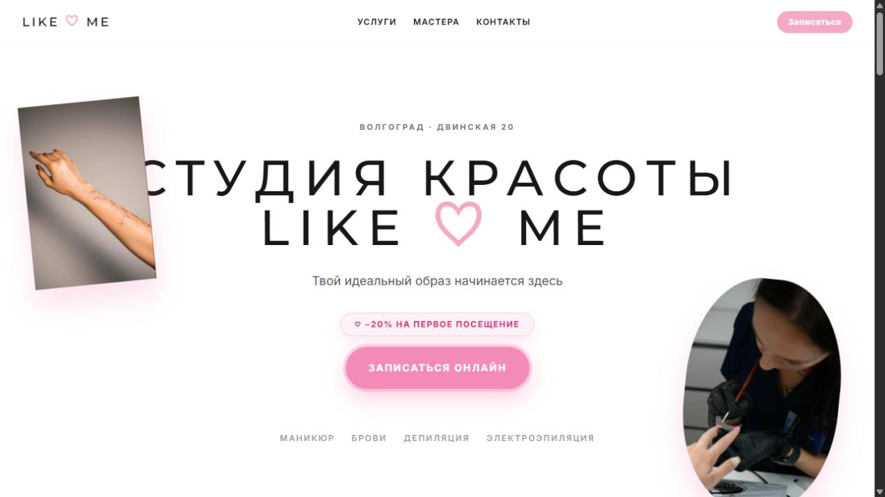

# LIKE ME

**Сайт студии красоты в Волгограде** · [Открыть сайт](https://like-me-vlg-cta.vercel.app/) · [Вернуться в профиль](../README.md)

## Задача

Перед записью человеку хочется понять, подходит ли студия: какие услуги доступны, кто их выполняет, как выглядит пространство и где оно находится. Если ответы разбросаны по социальным сетям, путь к записи становится длиннее. LIKE ME собирает эту информацию на одной странице и ведёт посетителя к онлайн-записи.

## Что есть на сайте

- Четыре раскрывающихся направления услуг: маникюр, брови, депиляция и электроэпиляция. Внутри можно изучить варианты и цены.
- Блок команды с четырьмя специалистами. Карточки открывают подробности о мастерах, помогая выбрать человека, к которому хочется записаться.
- Галерея студии и работ с увеличением фотографий, отзывы и описание программы лояльности.
- Контакты, карта, социальные сети и переход к записи через Dikidi.

## Польза для клиента и студии

Клиент может спокойно сравнить услуги, познакомиться с мастерами и принять решение до перехода во внешний сервис записи. Студия получает цельную витрину: ключевые вопросы закрыты на сайте, а заметные кнопки записи доступны в нужных местах страницы. Это особенно важно для услуг, где доверие к специалисту и впечатление от пространства влияют на выбор.

**Что показывает проект:** работа с визуальной подачей услуг, карточками команды, галереей, мобильной навигацией и понятным переходом в систему записи.

*Публичная версия проверена 15 октября 2026 года. Актуальные услуги, цены и свободное время следует уточнять в системе записи студии.*
