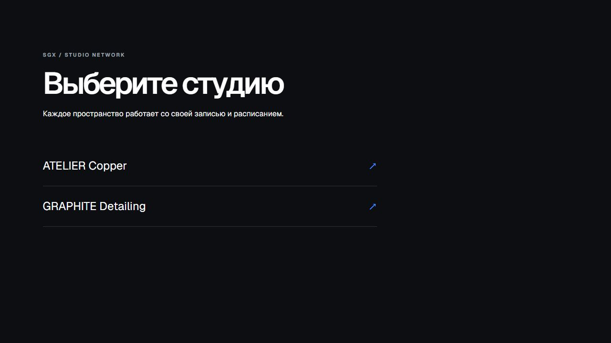

# SGX Booking

**Каталог студий и интерфейс записи** · [Открыть демо](https://sgx-booking-pwa.vercel.app/) · [Вернуться в профиль](../README.md)

## Задача

Когда у бизнеса несколько пространств, общая форма записи может путать посетителя: услуги и свободное время разных студий смешиваются. SGX Booking начинается с выбора конкретного пространства. На публичной стартовой странице представлены ATELIER Copper и GRAPHITE Detailing. Каждый пункт ведёт к своему разделу, где предполагается отдельный сценарий записи и расписание.

## Что даёт такая структура

Посетитель сначала выбирает нужную студию, а затем должен работать с её услугами и доступным временем. Для бизнеса это основа, которую можно расширять на несколько направлений без единого перегруженного списка. Стартовый каталог оформлен как самостоятельный экран: у каждой студии своя карточка и понятный переход.

## Состояние публичной версии

15 октября 2026 года каталог открывался, но страницы отдельных студий не смогли получить данные от сервера и показывали «Нет соединения / Failed to fetch». Поэтому я не представляю текущую публичную версию как полностью работающую запись и не описываю неподтверждённые шаги бронирования. Демо показывает архитектуру входа в сервис; проверить выбор времени можно после восстановления источника данных.

**Что показывает проект:** проектирование структуры записи для нескольких студий и разделение клиентских сценариев по пространствам.
