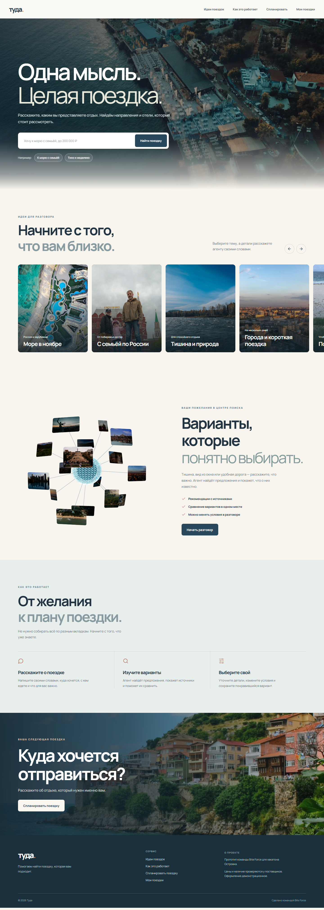
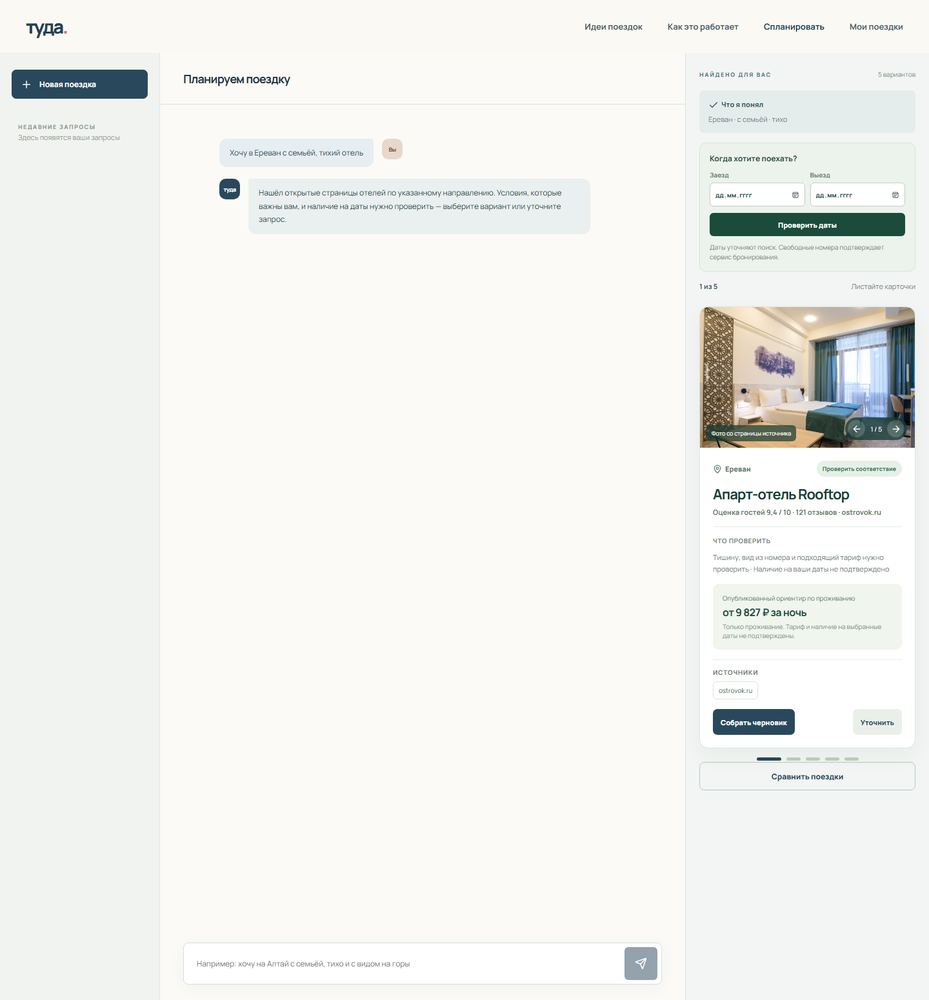
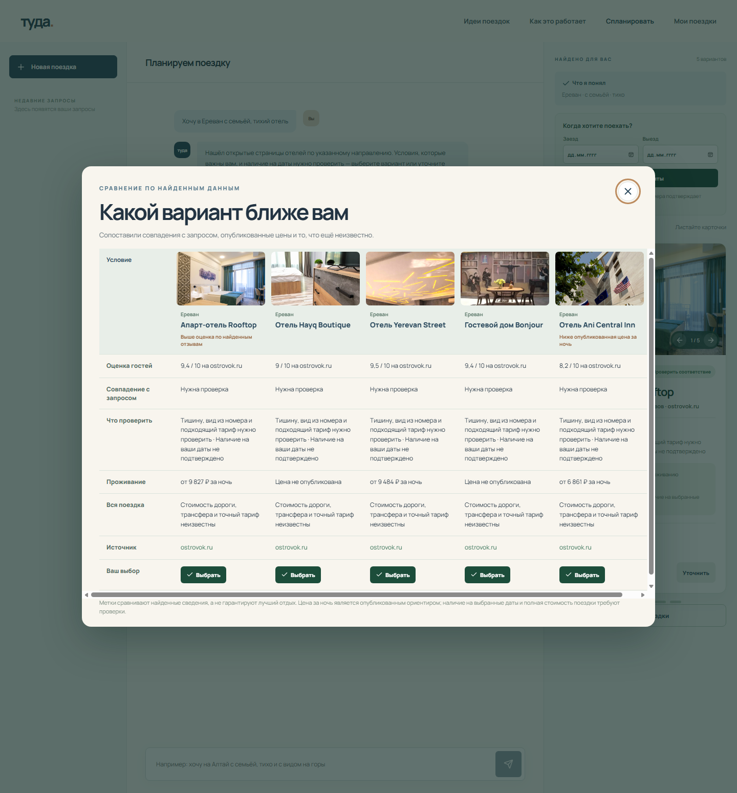
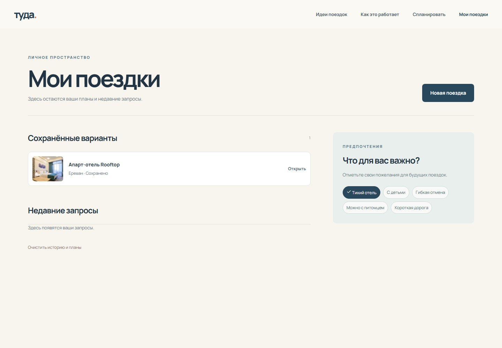

# Туда — помощник в планировании путешествий

**Travel AI · интерфейс и пользовательский сценарий · хакатон «О!дин запрос»**

[Открыть сервис](https://bite-force-web.vercel.app/) · [Видеообзор](https://bite-force-web.vercel.app/demo.mp4) · [Код команды Bite Force](https://github.com/ostrovok-hackathon-2026/byte-force) · [Все кейсы](../README.md)

«Туда» — веб-сервис, который помогает перейти от идеи отдыха к выбору отеля. Человек описывает поездку своими словами: куда хочет отправиться, с кем едет и что для него важно. Агент разбирает запрос, ищет открытые источники и показывает варианты для дальнейшего сравнения.

Проект создан командой Bite Force для трека «О!дин запрос» хакатона Островка. Я занимался проработкой концепции, интерфейса и пользовательского пути: от первого экрана и диалога до сравнения и сохранения вариантов. Разработка велась в команде с использованием инструментов ИИ.

## Задача

Планирование поездки начинается задолго до бронирования. Направление ещё не выбрано, даты могут меняться, а желания вроде «тихо с семьёй» или «красивый вид» трудно уместить в стандартные фильтры. При этом человеку приходится открывать несколько сайтов, запоминать условия и сопоставлять предложения.

Я хотел собрать этот путь в одном интерфейсе: дать возможность начать с обычной фразы, посмотреть фотографии и сведения об отелях, уточнить пожелания и сравнить найденные варианты. Решение рассчитано на путешествия по России и за рубежом; доступность конкретных направлений зависит от источников.

## Первый экран: начать с желания

На главной человек может сразу перейти к планированию, введя свой запрос, или выбрать близкую тему путешествия. Видео и визуальные подборки задают настроение, а навигация ведёт к диалогу, объяснению сервиса и сохранённым поездкам. Главная остаётся точкой входа: выбор темы помогает начать разговор, но не заменяет поиск конкретных предложений.

## Диалог и карточки отелей

В центре находится разговор с агентом; слева можно начать новую поездку и вернуться к недавним запросам. Справа размещены распознанные условия, выбор дат и найденные варианты. Карточка показывает сведения об объекте, источник, опубликованный ценовой ориентир и то, что нужно дополнительно проверить.

Карточки перелистываются целиком нажатием на край или свайпом. Фотографии внутри карточки можно листать отдельно, когда они доступны у источника. Кнопки «Уточнить» и «Собрать черновик» помогают продолжить диалог или сохранить вариант. Для пользователей с настройкой уменьшения движения предусмотрен переход без анимации.

## Сравнение

Кнопка «Сравнить поездки» открывает таблицу: в ней рядом находятся оценка гостей, совпадения с запросом, неопределённые условия, опубликованные цены и источники. Это позволяет увидеть различия, не запоминая сведения из отдельных карточек. Из таблицы можно выбрать вариант для черновика.

## Мои поездки и предпочтения

На странице «Мои поездки» собраны сохранённые варианты и недавние запросы. Здесь же можно отметить предпочтения — например, поездку с детьми или тихий отель — и очистить сохранённые данные. История и настройки веб-интерфейса хранятся в текущем браузере: авторизации и синхронизации между устройствами сейчас нет.

## Как устроен сервис

Интерфейс построен на **Next.js, React и TypeScript**. Серверный поиск использует **ProxyAPI, GPT-5 mini и web search**: модель помогает разобрать запрос и найти открытые источники. Приложение получает и проверяет доступные сведения, формирует карточки и показывает ссылки на страницы поставщиков. Для части направлений предусмотрен резервный поиск по открытым страницам отелей.

Для локального запуска предусмотрены **FastAPI, SQLite и Docker Compose**. На Vercel используется серверный маршрут Next.js. Подробности об архитектуре и настройке — в [README командного репозитория](https://github.com/ostrovok-hackathon-2026/byte-force#readme).

## Текущий результат и дальнейшее развитие

Сейчас сервис позволяет пройти путь от запроса до найденных карточек, сравнения и сохранённого черновика. Оформление заказа демонстрационное: оплата не списывается и номер не бронируется. Найденные цены служат ориентиром по опубликованным данным, а не подтверждённым тарифом на выбранные даты. Наличие номеров, условия, перелёты и трансферы необходимо проверять у поставщика; фотографии доступны не для каждого объекта.

Проект поставлен на паузу. Следующий шаг для развития — проверить сценарий с путешественниками и изучить партнёрские источники данных о доступности, тарифах и фотографиях. Это позволит оценить, какие возможности нужны людям и что необходимо для перехода к настоящему бронированию.

Снимки показывают тестовый сценарий с открытыми данными на момент записи. Цена и доступность предложений могли измениться.
